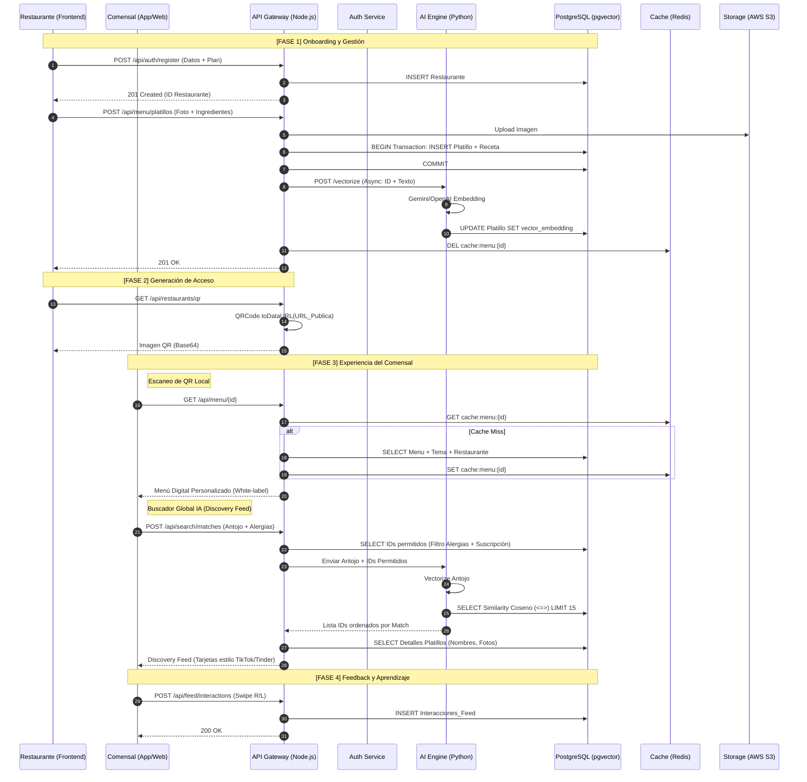

# 🌐 Diagrama de Secuencia Global: Ecosistema MexxicanMX

Este diagrama representa el flujo completo de vida de la aplicación, desde que un restaurante se registra hasta que un comensal recibe recomendaciones inteligentes basadas en IA.

---

## 🗝️ Explicación de los Componentes Críticos

1.  **Auth Service (Nº 1-3):** Gestiona el acceso RBAC. Si un restaurante no tiene la suscripción activa (bloqueo por Super Admin), el acceso al menú devuelve un 403.
2.  **Vectorización Asíncrona (Nº 6-9):** Cuando se crea un platillo, la API de Node no espera a que la IA termine. Envía la respuesta al usuario y el proceso de IA ocurre en segundo plano para no bloquear la UX.
3.  **Algoritmo Híbrido de Búsqueda (Nº 16-21):** 
    *   **Filtro Duro (Node.js):** Seguridad alimentaria (alergias) y comercial (pago).
    *   **Filtro Semántico (Python/pgvector):** Encuentra el "antojo" exacto del usuario mediante matemáticas vectoriales.
4.  **Caché White-label (Nº 12-15):** El diseño personalizado (colores, fuentes) se sirve desde Redis para garantizar que la "primera impresión" del comensal sea instantánea.

---

## 🛠️ Tecnologías Involucradas
*   **Backend:** Node.js (Express), Python (FastAPI).
*   **Bases de Datos:** PostgreSQL con extensión `pgvector`, Redis Stack.
*   **Infraestructura:** Docker Compose, AWS S3.
*   **IA:** Modelos de Embedding (Google Gemini / OpenAI).
