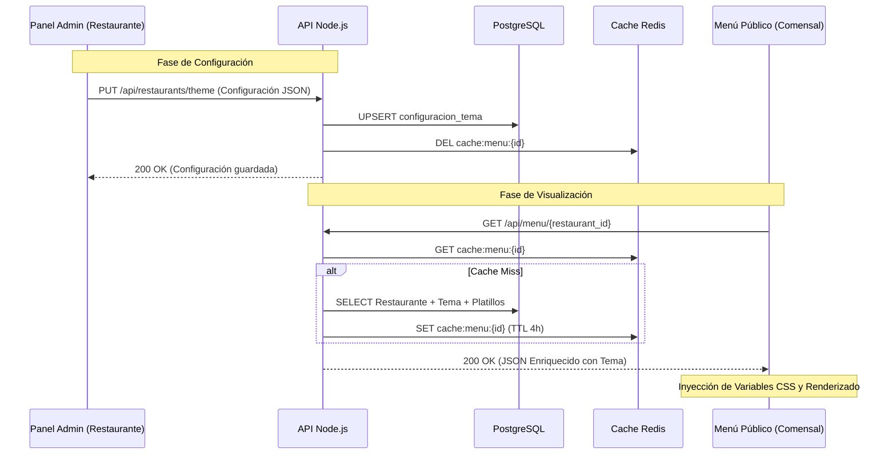

# 📘 Guía de Integración: Funcionalidad White-label Premium

Este documento detalla cómo deben interactuar el Frontend (React) y el Backend (Node.js) para la personalización de marca de los restaurantes en MexxicanMX.

---

## 1. 🔄 Diagrama de Secuencia (Flujo de Personalización)

Este diagrama muestra el flujo desde que el dueño del restaurante configura su marca hasta que el comensal visualiza el menú con los estilos aplicados.



---

## 2. 🎨 Funcionamiento en el Frontend

### A. Panel de Administración (Configuración)
Kevin debe enviar un objeto JSON al endpoint `PUT /api/restaurants/theme`. 

**Recomendación:** Usar un selector de color (como `react-color`) y un selector de fuentes predefinidas.

```javascript
// Ejemplo de llamada desde el Panel Admin
const saveBranding = async (config) => {
  await axios.put('/api/restaurants/theme', config, {
    headers: { Authorization: `Bearer ${token}` }
  });
};
```

### B. Menú Público (Visualización Dinámica)
La clave del rendimiento es **no usar lógica compleja de estilos en JS**, sino delegar a **Variables CSS**.

1.  **Recepción de Datos:** El frontend recibe el objeto `tema` dentro de la respuesta del menú.
2.  **Inyección de Variables:** Se aplican al contenedor raíz del componente.
3.  **Mapeo de Layout:** Se usa el campo `layout_type` para decidir qué componente de lista renderizar.

#### Ejemplo de Mapeo de Layout:
```tsx
const LayoutRenderer = ({ type, dishes }) => {
  switch(type) {
    case 'LISTA_SIMPLE': return <SimpleList data={dishes} />;
    case 'CUADRICULA_FOTOS': return <PhotoGrid data={dishes} />;
    case 'TARJETAS_DETALLADAS': return <DetailedCards data={dishes} />;
    default: return <DetailedCards data={dishes} />;
  }
};
```

---

## 3. 🛠️ Contrato de Datos (JSON)

### Request (Admin -> API)
```json
{
  "logo_url": "string",
  "banner_url": "string",
  "color_primario": "#HEX",
  "color_fondo": "#HEX",
  "fuente_familia": "Serif | Sans-Serif | Mono",
  "layout_type": "LISTA_SIMPLE | CUADRICULA_FOTOS | TARJETAS_DETALLADAS",
  "banner_promocional_activo": boolean,
  "banner_promocional_texto": "string"
}
```

### Response (API -> Comensal)
```json
{
  "restaurante": {
    "nombre": "Nombre del Negocio",
    "tema": { ... objeto_tema ... }
  },
  "categorias": [
    {
      "nombre": "Categoría A",
      "platillos": [ { "id": "...", "nombre": "...", "precio": 0, "url_imagen": "..." } ]
    }
  ]
}
```

---

## 4. 🚀 Beneficios de esta Arquitectura

1.  **Carga Instantánea:** Al estar cacheado en Redis, el menú personalizado carga en milisegundos.
2.  **Flexibilidad Total:** El restaurante puede cambiar su color de marca en segundos sin que el desarrollador tenga que tocar código.
3.  **Mantenibilidad:** Kevin solo tiene que crear 3 componentes de layout; la API decide cuál mostrar según la preferencia del cliente.
