# 📊 Auditoría Completa - Configuración de Imágenes Responsivas

**Fecha:** 2026-07-29T21:01:17.872Z
**Total de Breakpoints:** 6
**✅ Pasaron:** 0/6
**❌ Fallaron:** 6/6

## 📋 Resumen por Breakpoint

| Breakpoint | Estado | Errores | Notas |
|-----------|--------|---------|-------|
| Desktop XL | ❌ FALLÓ | 1 | Configuration saved successfully; Public menu screenshot captured |
| Desktop | ❌ FALLÓ | 1 | Configuration saved successfully; Public menu screenshot captured |
| Laptop | ❌ FALLÓ | 1 | Configuration saved successfully; Public menu screenshot captured |
| Tablet | ❌ FALLÓ | 1 | Configuration saved successfully; Public menu screenshot captured |
| Móvil Standard | ❌ FALLÓ | 1 | Configuration saved successfully; Public menu screenshot captured |
| Móvil Pequeño | ❌ FALLÓ | 1 | Configuration saved successfully; Public menu screenshot captured |

## 📸 Detalles por Breakpoint

### Desktop XL
**Estado:** ❌ FALLÓ

**Editor:**
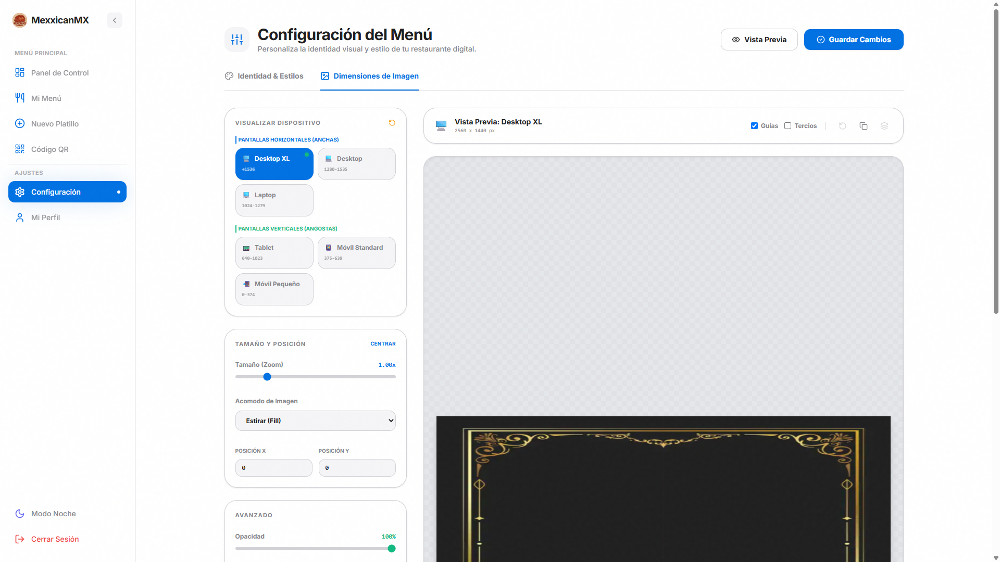

**Menú Público:**
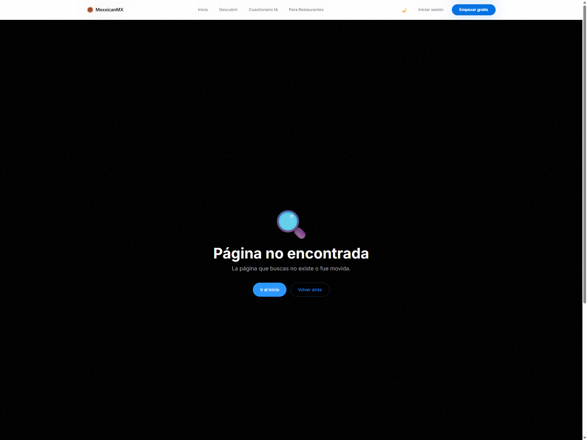

**Notas:**
- Configuration saved successfully
- Public menu screenshot captured

**Errores:**
- ⚠️ Configuration not persisted. Expected 'fill', got 'cover'

---

### Desktop
**Estado:** ❌ FALLÓ

**Editor:**

**Menú Público:**
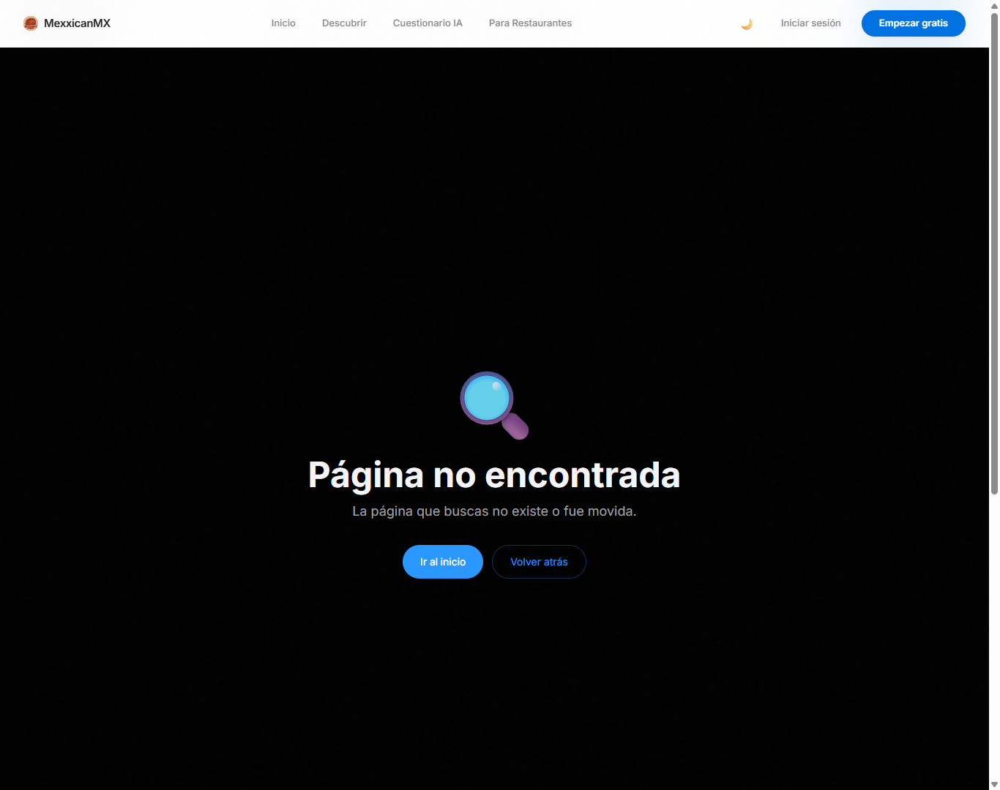

**Notas:**
- Configuration saved successfully
- Public menu screenshot captured

**Errores:**
- ⚠️ Configuration not persisted. Expected 'fill', got 'cover'

---

### Laptop
**Estado:** ❌ FALLÓ

**Editor:**
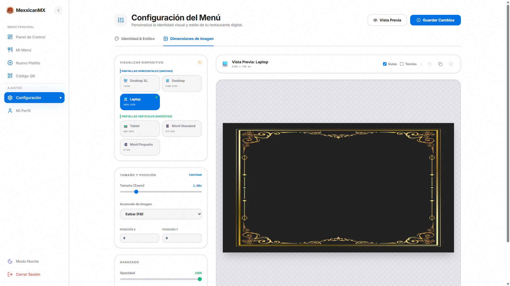

**Menú Público:**
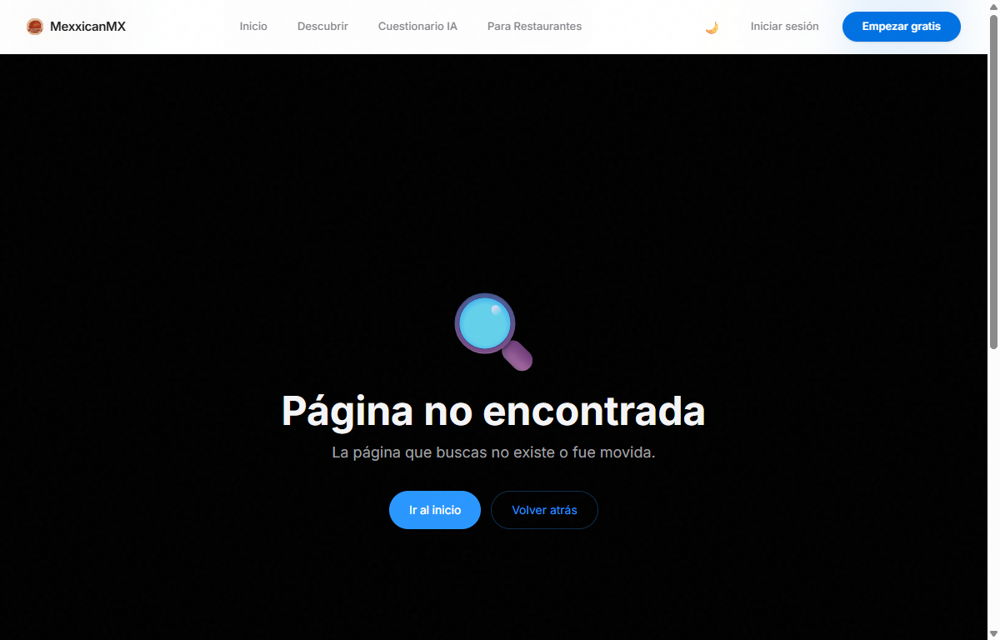

**Notas:**
- Configuration saved successfully
- Public menu screenshot captured

**Errores:**
- ⚠️ Configuration not persisted. Expected 'fill', got 'cover'

---

### Tablet
**Estado:** ❌ FALLÓ

**Editor:**
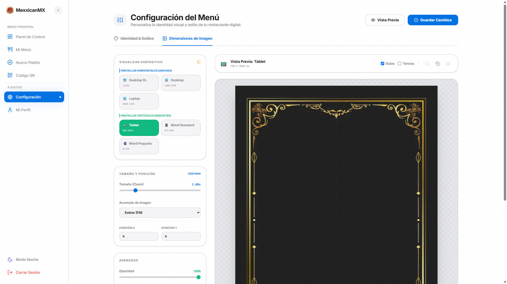

**Menú Público:**
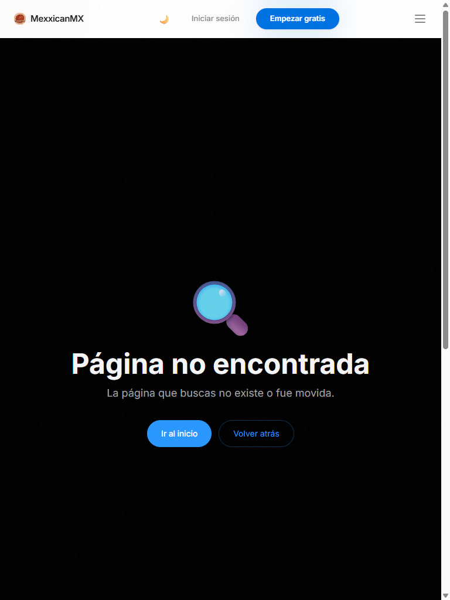

**Notas:**
- Configuration saved successfully
- Public menu screenshot captured

**Errores:**
- ⚠️ Configuration not persisted. Expected 'fill', got 'cover'

---

### Móvil Standard
**Estado:** ❌ FALLÓ

**Editor:**
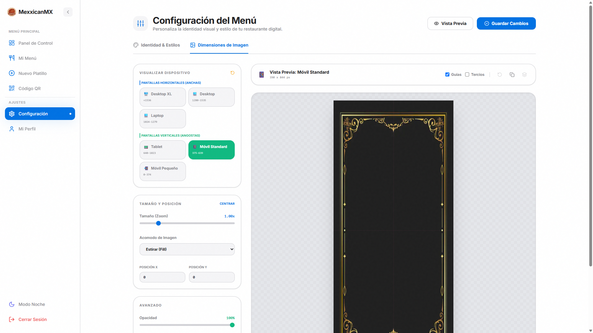

**Menú Público:**
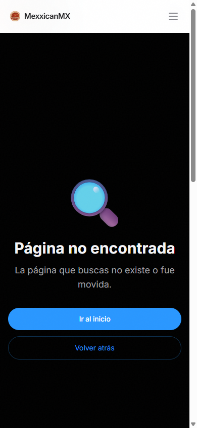

**Notas:**
- Configuration saved successfully
- Public menu screenshot captured

**Errores:**
- ⚠️ Configuration not persisted. Expected 'fill', got 'cover'

---

### Móvil Pequeño
**Estado:** ❌ FALLÓ

**Editor:**
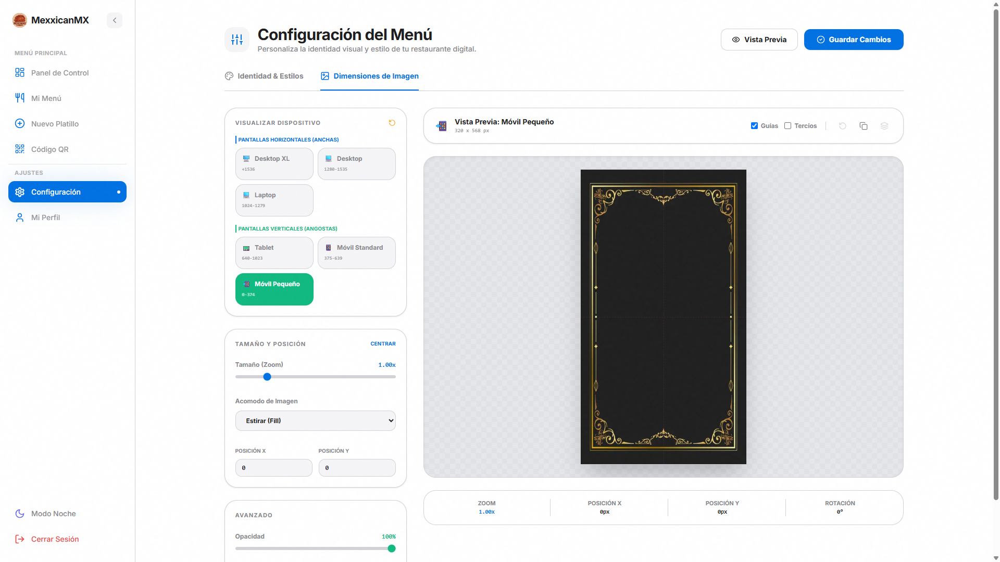

**Menú Público:**
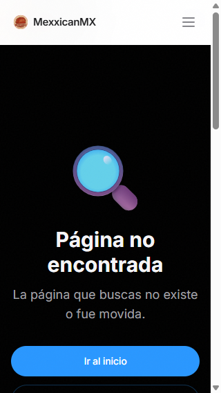

**Notas:**
- Configuration saved successfully
- Public menu screenshot captured

**Errores:**
- ⚠️ Configuration not persisted. Expected 'fill', got 'cover'

---

