# Auditoría Completa de Configuración de Imágenes

**Fecha:** 2026-07-30T01:43:52.305Z
**Total Breakpoints:** 6
**✅ Pasaron:** 5/6
**❌ Fallaron:** 1/6
**🐛 Bugs encontrados:** 2

## Resumen Ejecutivo

| Breakpoint | Estado | ObjectFit Editor | ObjectFit Público | CSS Match | Persistencia | UI Persistida | Bugs |
|---|---|---|---|---|---|---|
| Desktop XL (desktop_large) | ✅ PASÓ | fill | fill | ✅ | ✅ | ✅ | 0 |
| Desktop (desktop) | ❌ FALLÓ | fill | fill | ❌ | ✅ | ✅ | 2 |
| Laptop (laptop) | ✅ PASÓ | fill | fill | ✅ | ✅ | ✅ | 0 |
| Tablet (tablet) | ✅ PASÓ | fill | fill | ✅ | ✅ | ✅ | 0 |
| Móvil Standard (mobile) | ✅ PASÓ | fill | fill | ✅ | ✅ | ✅ | 0 |
| Móvil Pequeño (mobile_small) | ✅ PASÓ | fill | fill | ✅ | ✅ | ✅ | 0 |

## Desktop XL (desktop_large)

**Estado:** ✅ PASÓ
**Grupo:** horizontal

### Capturas

**Editor:**
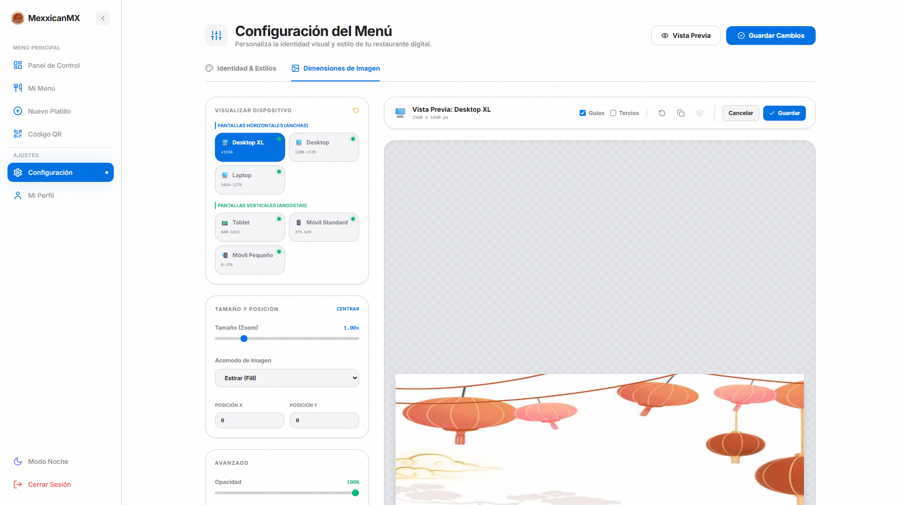

**Menú Público:**
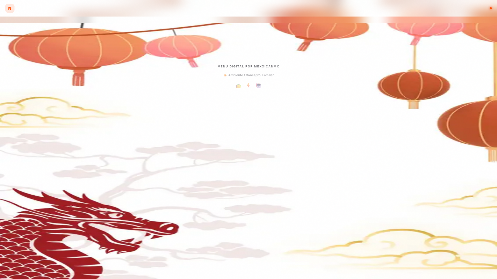

### Propiedades CSS

| Propiedad | Editor | Menú Público | Coinciden? |
|---|---|---|---|
| width | 2560px | 2560px | ✅ |
| height | 1440px | 1440px | ✅ |
| objectFit | fill | fill | ✅ |
| transform | none | none | ✅ |
| borderRadius | 0px | 0px | ✅ |
| opacity | 1 | 1 | ✅ |
| zIndex | auto | auto | ✅ |

### Persistencia

- **object_fit guardado como "fill":** ✅ Sí
- **UI refleja valor persistido:** ✅ Sí

**Respuesta del servidor al guardar:**
```json
{
  "mensaje": "Configuración de marca actualizada correctamente",
  "tema": {
    "id": "5222e341-1ac0-40f2-852f-d660892500ee",
    "restaurante_id": "51ad632a-403d-426e-bfb4-2d32a448bb7b",
    "logo_url": "",
    "banner_url": null,
    "color_primario": "#FF4A00",
    "color_fondo": "#0A0A0A",
    "fuente_familia": "Sans-Serif",
    "layout_type": "TARJETAS_DETALLADAS",
    "banner_promocional_activo": false,
    "banner_promocional_texto": "",
    "config_diseno": {
      "layout": {
        "categorias_sticky": true,
        "layout_type_vertical": "TARJETAS_DETALLADAS",
        "layout_type_horizontal": "TARJETAS_DETALLADAS"
      },
      "apariencia": {
        "fondo_blur": "0px",
        "fondo_tipo": "imagen",
        "color_fondo": "#0A0A0A",
        "fondo_valor": "#0A0A0A",
        "modo_oscuro": true,
        "color_normal": "#ffffff",
        "color_primario": "#FF4A00",
        "fondo_imagen_x": 0,
        "fondo_imagen_y": 0,
        "fuente_familia": "Sans-Serif",
        "fondo_imagen_url": "https://d13mim0hny1xpb.cloudfront.net/dishes/1785367031587-712226456.webp",
        "color_descripcion": "#8e8e93",
        "fondo_imagen_blur": 0,
        "fondo_imagen_zoom": 1,
        "responsive_imagen": {
          "laptop": {
            "scale": 1,
            "width": 300,
            "custom": true,
            "height": 300,
            "opacity": 100,
            "z_index": 0,
            "rotation": 0,
            "object_fit": "fill",
            "position_x": 50,
            "position_y": 50,
            "border_radius": 0
          },
          "mobile": {
            "scale": 1,
            "width": 768,
            "custom": true,
            "height": 1024,
            "opacity": 100,
            "z_index": 1,
            "rotation": 0,
            "object_fit": "fill",
            "position_x": 0,
            "position_y": 0,
            "border_radius": 0
          },
          "tablet": {
            "scale": 1,
            "width": 768,
            "custom": true,
            "height": 1024,
            "opacity": 100,
            "z_index": 1,
            "rotation": 0,
            "object_fit": "fill",
            "position_x": 0,
            "position_y": 0,
            "border_radius": 0
          },
          "desktop": {
            "scale": 1,
            "width": 300,
            "custom": true,
            "height": 300,
            "opacity": 100,
            "z_index": 0,
            "rotation": 0,
            "object_fit": "fill",
            "position_x": 50,
            "position_y": 50,
            "border_radius": 0
          },
          "mobile_small": {
            "scale": 1,
            "width": 768,
            "custom": true,
            "height": 1024,
            "opacity": 100,
            "z_index": 1,
            "rotation": 0,
            "object_fit": "fill",
            "position_x": 0,
            "position_y": 0,
            "border_radius": 0
          },
          "desktop_large": {
            "scale": 1,
            "width": 2560,
            "custom": true,
            "height": 1440,
            "opacity": 100,
            "z_index": 1,
            "rotation": 0,
            "object_fit": "fill",
            "position_x": 0,
            "position_y": 0,
            "border_radius": 0
          }
        },
        "fondo_imagen_rotate": 0,
        "fondo_imagen_opacity": 100,
        "border_radius_botones": "12px",
        "fondo_imagen_contrast": 100,
        "fondo_imagen_saturate": 100,
        "fondo_overlay_opacity": 0,
        "border_radius_tarjetas": "24px",
        "fondo_imagen_brightness": 100,
        "fondo_overlay_gradient_active": false
      },
      "informacion": {
        "ambiente": "Familiar",
        "direccion": ""
      },
      "elementos_visuales": {
        "glassmorphism": false,
        "sombras_habilitadas": true
      }
    },
    "updated_at": "2026-07-30T01:41:17.565Z"
  }
}
```

---

## Desktop (desktop)

**Estado:** ❌ FALLÓ
**Grupo:** horizontal

### Capturas

**Editor:**


**Menú Público:**
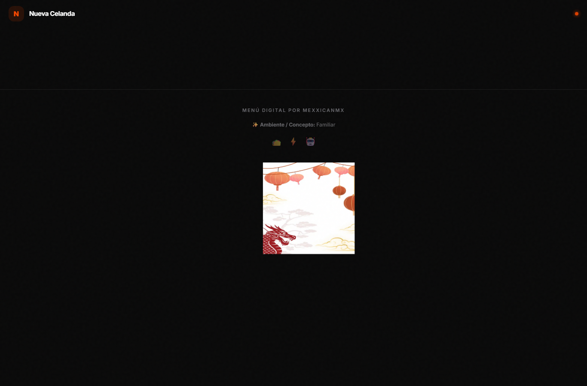

### Propiedades CSS

| Propiedad | Editor | Menú Público | Coinciden? |
|---|---|---|---|
| width | 2560px | 300px | ❌ |
| height | 1440px | 300px | ❌ |
| objectFit | fill | fill | ✅ |
| transform | none | none | ✅ |
| borderRadius | 0px | 0px | ✅ |
| opacity | 1 | 1 | ✅ |
| zIndex | auto | auto | ✅ |

### Persistencia

- **object_fit guardado como "fill":** ✅ Sí
- **UI refleja valor persistido:** ✅ Sí

**Respuesta del servidor al guardar:**
```json
{
  "mensaje": "Configuración de marca actualizada correctamente",
  "tema": {
    "id": "5222e341-1ac0-40f2-852f-d660892500ee",
    "restaurante_id": "51ad632a-403d-426e-bfb4-2d32a448bb7b",
    "logo_url": "",
    "banner_url": null,
    "color_primario": "#FF4A00",
    "color_fondo": "#0A0A0A",
    "fuente_familia": "Sans-Serif",
    "layout_type": "TARJETAS_DETALLADAS",
    "banner_promocional_activo": false,
    "banner_promocional_texto": "",
    "config_diseno": {
      "layout": {
        "categorias_sticky": true,
        "layout_type_vertical": "TARJETAS_DETALLADAS",
        "layout_type_horizontal": "TARJETAS_DETALLADAS"
      },
      "apariencia": {
        "fondo_blur": "0px",
        "fondo_tipo": "imagen",
        "color_fondo": "#0A0A0A",
        "fondo_valor": "#0A0A0A",
        "modo_oscuro": true,
        "color_normal": "#ffffff",
        "color_primario": "#FF4A00",
        "fondo_imagen_x": 0,
        "fondo_imagen_y": 0,
        "fuente_familia": "Sans-Serif",
        "fondo_imagen_url": "https://d13mim0hny1xpb.cloudfront.net/dishes/1785367031587-712226456.webp",
        "color_descripcion": "#8e8e93",
        "fondo_imagen_blur": 0,
        "fondo_imagen_zoom": 1,
        "responsive_imagen": {
          "laptop": {
            "scale": 1,
            "width": 300,
            "custom": true,
            "height": 300,
            "opacity": 100,
            "z_index": 0,
            "rotation": 0,
            "object_fit": "fill",
            "position_x": 50,
            "position_y": 50,
            "border_radius": 0
          },
          "mobile": {
            "scale": 1,
            "width": 768,
            "custom": true,
            "height": 1024,
            "opacity": 100,
            "z_index": 1,
            "rotation": 0,
            "object_fit": "fill",
            "position_x": 0,
            "position_y": 0,
            "border_radius": 0
          },
          "tablet": {
            "scale": 1,
            "width": 768,
            "custom": true,
            "height": 1024,
            "opacity": 100,
            "z_index": 1,
            "rotation": 0,
            "object_fit": "fill",
            "position_x": 0,
            "position_y": 0,
            "border_radius": 0
          },
          "desktop": {
            "scale": 1,
            "width": 300,
            "custom": true,
            "height": 300,
            "opacity": 100,
            "z_index": 0,
            "rotation": 0,
            "object_fit": "fill",
            "position_x": 50,
            "position_y": 50,
            "border_radius": 0
          },
          "mobile_small": {
            "scale": 1,
            "width": 768,
            "custom": true,
            "height": 1024,
            "opacity": 100,
            "z_index": 1,
            "rotation": 0,
            "object_fit": "fill",
            "position_x": 0,
            "position_y": 0,
            "border_radius": 0
          },
          "desktop_large": {
            "scale": 1,
            "width": 2560,
            "custom": true,
            "height": 1440,
            "opacity": 100,
            "z_index": 1,
            "rotation": 0,
            "object_fit": "fill",
            "position_x": 0,
            "position_y": 0,
            "border_radius": 0
          }
        },
        "fondo_imagen_rotate": 0,
        "fondo_imagen_opacity": 100,
        "border_radius_botones": "12px",
        "fondo_imagen_contrast": 100,
        "fondo_imagen_saturate": 100,
        "fondo_overlay_opacity": 0,
        "border_radius_tarjetas": "24px",
        "fondo_imagen_brightness": 100,
        "fondo_overlay_gradient_active": false
      },
      "informacion": {
        "ambiente": "Familiar",
        "direccion": ""
      },
      "elementos_visuales": {
        "glassmorphism": false,
        "sombras_habilitadas": true
      }
    },
    "updated_at": "2026-07-30T01:41:47.670Z"
  }
}
```

### Bugs Encontrados (2)

#### Bug #1: Editor-Public CSS comparison

- **Breakpoint:** Desktop (undefined)
- **Paso:** Editor-Public CSS comparison
- **Propiedad CSS:** width
- **Esperado:** width: "2560px" (editor)
- **Observado:** width: "300px" (public menu)
- **Valor en Editor:** 2560px
- **Valor en Menú Público:** 300px
- **Causa Posible:** Mismatch in width between editor canvas and public menu rendering — scaling or inheritance logic may differ
- **Componente Responsable:** PublicMenu
- **Archivo:** frontend/src/pages/PublicMenu/PublicMenu.tsx
- **Solución Propuesta:** Ensure public menu applies the same width value as the editor from the resolved breakpoint config

#### Bug #2: Editor-Public CSS comparison

- **Breakpoint:** Desktop (undefined)
- **Paso:** Editor-Public CSS comparison
- **Propiedad CSS:** height
- **Esperado:** height: "1440px" (editor)
- **Observado:** height: "300px" (public menu)
- **Valor en Editor:** 1440px
- **Valor en Menú Público:** 300px
- **Causa Posible:** Mismatch in height between editor canvas and public menu rendering — scaling or inheritance logic may differ
- **Componente Responsable:** PublicMenu
- **Archivo:** frontend/src/pages/PublicMenu/PublicMenu.tsx
- **Solución Propuesta:** Ensure public menu applies the same height value as the editor from the resolved breakpoint config

---

## Laptop (laptop)

**Estado:** ✅ PASÓ
**Grupo:** horizontal

### Capturas

**Editor:**
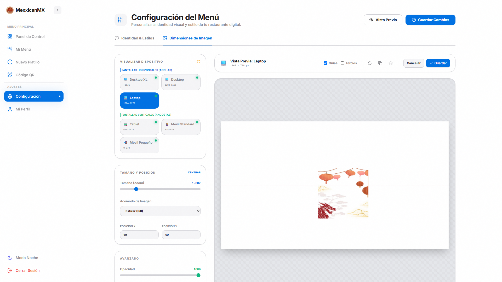

**Menú Público:**
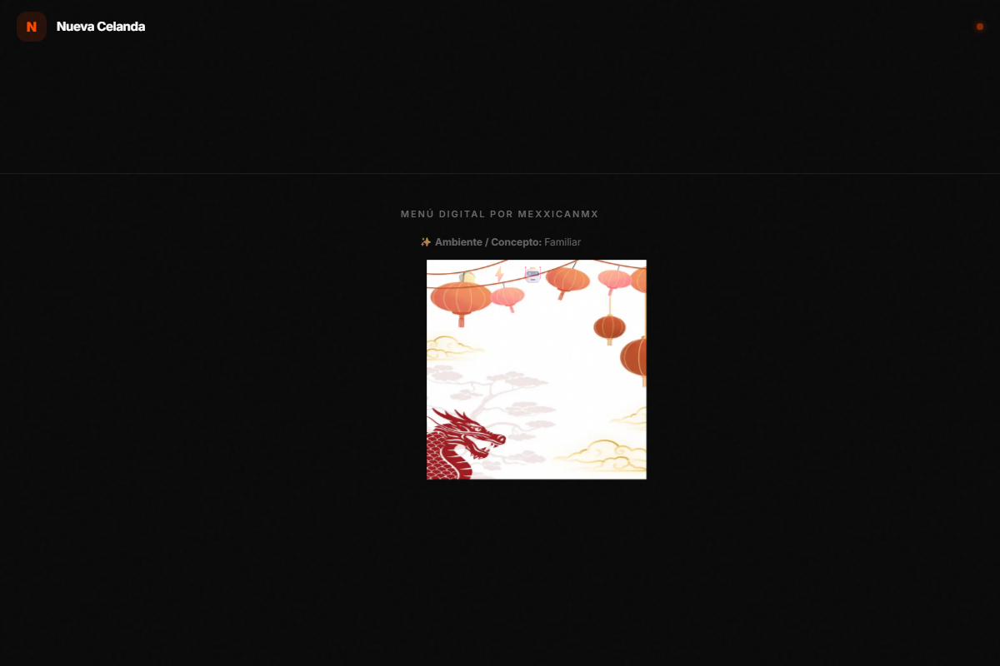

### Propiedades CSS

| Propiedad | Editor | Menú Público | Coinciden? |
|---|---|---|---|
| width | 300px | 300px | ✅ |
| height | 300px | 300px | ✅ |
| objectFit | fill | fill | ✅ |
| transform | none | none | ✅ |
| borderRadius | 0px | 0px | ✅ |
| opacity | 1 | 1 | ✅ |
| zIndex | auto | auto | ✅ |

### Persistencia

- **object_fit guardado como "fill":** ✅ Sí
- **UI refleja valor persistido:** ✅ Sí

**Respuesta del servidor al guardar:**
```json
{
  "mensaje": "Configuración de marca actualizada correctamente",
  "tema": {
    "id": "5222e341-1ac0-40f2-852f-d660892500ee",
    "restaurante_id": "51ad632a-403d-426e-bfb4-2d32a448bb7b",
    "logo_url": "",
    "banner_url": null,
    "color_primario": "#FF4A00",
    "color_fondo": "#0A0A0A",
    "fuente_familia": "Sans-Serif",
    "layout_type": "TARJETAS_DETALLADAS",
    "banner_promocional_activo": false,
    "banner_promocional_texto": "",
    "config_diseno": {
      "layout": {
        "categorias_sticky": true,
        "layout_type_vertical": "TARJETAS_DETALLADAS",
        "layout_type_horizontal": "TARJETAS_DETALLADAS"
      },
      "apariencia": {
        "fondo_blur": "0px",
        "fondo_tipo": "imagen",
        "color_fondo": "#0A0A0A",
        "fondo_valor": "#0A0A0A",
        "modo_oscuro": true,
        "color_normal": "#ffffff",
        "color_primario": "#FF4A00",
        "fondo_imagen_x": 0,
        "fondo_imagen_y": 0,
        "fuente_familia": "Sans-Serif",
        "fondo_imagen_url": "https://d13mim0hny1xpb.cloudfront.net/dishes/1785367031587-712226456.webp",
        "color_descripcion": "#8e8e93",
        "fondo_imagen_blur": 0,
        "fondo_imagen_zoom": 1,
        "responsive_imagen": {
          "laptop": {
            "scale": 1,
            "width": 300,
            "custom": true,
            "height": 300,
            "opacity": 100,
            "z_index": 0,
            "rotation": 0,
            "object_fit": "fill",
            "position_x": 50,
            "position_y": 50,
            "border_radius": 0
          },
          "mobile": {
            "scale": 1,
            "width": 768,
            "custom": true,
            "height": 1024,
            "opacity": 100,
            "z_index": 1,
            "rotation": 0,
            "object_fit": "fill",
            "position_x": 0,
            "position_y": 0,
            "border_radius": 0
          },
          "tablet": {
            "scale": 1,
            "width": 768,
            "custom": true,
            "height": 1024,
            "opacity": 100,
            "z_index": 1,
            "rotation": 0,
            "object_fit": "fill",
            "position_x": 0,
            "position_y": 0,
            "border_radius": 0
          },
          "desktop": {
            "scale": 1,
            "width": 300,
            "custom": true,
            "height": 300,
            "opacity": 100,
            "z_index": 0,
            "rotation": 0,
            "object_fit": "fill",
            "position_x": 50,
            "position_y": 50,
            "border_radius": 0
          },
          "mobile_small": {
            "scale": 1,
            "width": 768,
            "custom": true,
            "height": 1024,
            "opacity": 100,
            "z_index": 1,
            "rotation": 0,
            "object_fit": "fill",
            "position_x": 0,
            "position_y": 0,
            "border_radius": 0
          },
          "desktop_large": {
            "scale": 1,
            "width": 2560,
            "custom": true,
            "height": 1440,
            "opacity": 100,
            "z_index": 1,
            "rotation": 0,
            "object_fit": "fill",
            "position_x": 0,
            "position_y": 0,
            "border_radius": 0
          }
        },
        "fondo_imagen_rotate": 0,
        "fondo_imagen_opacity": 100,
        "border_radius_botones": "12px",
        "fondo_imagen_contrast": 100,
        "fondo_imagen_saturate": 100,
        "fondo_overlay_opacity": 0,
        "border_radius_tarjetas": "24px",
        "fondo_imagen_brightness": 100,
        "fondo_overlay_gradient_active": false
      },
      "informacion": {
        "ambiente": "Familiar",
        "direccion": ""
      },
      "elementos_visuales": {
        "glassmorphism": false,
        "sombras_habilitadas": true
      }
    },
    "updated_at": "2026-07-30T01:42:18.035Z"
  }
}
```

---

## Tablet (tablet)

**Estado:** ✅ PASÓ
**Grupo:** vertical

### Capturas

**Editor:**
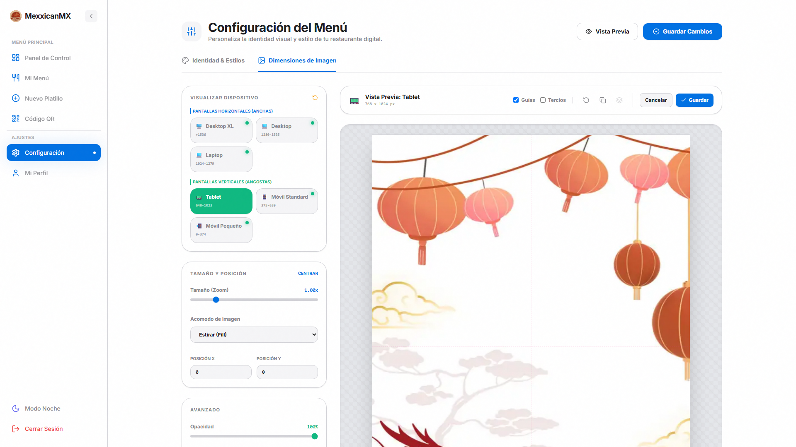

**Menú Público:**
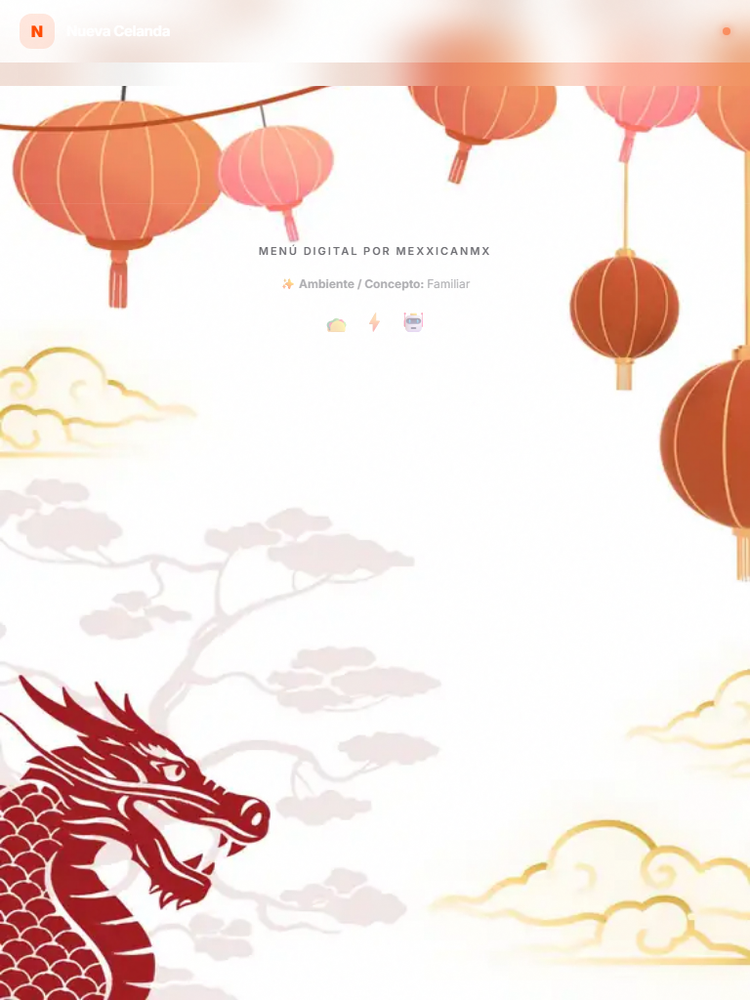

### Propiedades CSS

| Propiedad | Editor | Menú Público | Coinciden? |
|---|---|---|---|
| width | 768px | 768px | ✅ |
| height | 1024px | 1024px | ✅ |
| objectFit | fill | fill | ✅ |
| transform | none | none | ✅ |
| borderRadius | 0px | 0px | ✅ |
| opacity | 1 | 1 | ✅ |
| zIndex | auto | auto | ✅ |

### Persistencia

- **object_fit guardado como "fill":** ✅ Sí
- **UI refleja valor persistido:** ✅ Sí

**Respuesta del servidor al guardar:**
```json
{
  "mensaje": "Configuración de marca actualizada correctamente",
  "tema": {
    "id": "5222e341-1ac0-40f2-852f-d660892500ee",
    "restaurante_id": "51ad632a-403d-426e-bfb4-2d32a448bb7b",
    "logo_url": "",
    "banner_url": null,
    "color_primario": "#FF4A00",
    "color_fondo": "#0A0A0A",
    "fuente_familia": "Sans-Serif",
    "layout_type": "TARJETAS_DETALLADAS",
    "banner_promocional_activo": false,
    "banner_promocional_texto": "",
    "config_diseno": {
      "layout": {
        "categorias_sticky": true,
        "layout_type_vertical": "TARJETAS_DETALLADAS",
        "layout_type_horizontal": "TARJETAS_DETALLADAS"
      },
      "apariencia": {
        "fondo_blur": "0px",
        "fondo_tipo": "imagen",
        "color_fondo": "#0A0A0A",
        "fondo_valor": "#0A0A0A",
        "modo_oscuro": true,
        "color_normal": "#ffffff",
        "color_primario": "#FF4A00",
        "fondo_imagen_x": 0,
        "fondo_imagen_y": 0,
        "fuente_familia": "Sans-Serif",
        "fondo_imagen_url": "https://d13mim0hny1xpb.cloudfront.net/dishes/1785367031587-712226456.webp",
        "color_descripcion": "#8e8e93",
        "fondo_imagen_blur": 0,
        "fondo_imagen_zoom": 1,
        "responsive_imagen": {
          "laptop": {
            "scale": 1,
            "width": 300,
            "custom": true,
            "height": 300,
            "opacity": 100,
            "z_index": 0,
            "rotation": 0,
            "object_fit": "fill",
            "position_x": 50,
            "position_y": 50,
            "border_radius": 0
          },
          "mobile": {
            "scale": 1,
            "width": 768,
            "custom": true,
            "height": 1024,
            "opacity": 100,
            "z_index": 1,
            "rotation": 0,
            "object_fit": "fill",
            "position_x": 0,
            "position_y": 0,
            "border_radius": 0
          },
          "tablet": {
            "scale": 1,
            "width": 768,
            "custom": true,
            "height": 1024,
            "opacity": 100,
            "z_index": 1,
            "rotation": 0,
            "object_fit": "fill",
            "position_x": 0,
            "position_y": 0,
            "border_radius": 0
          },
          "desktop": {
            "scale": 1,
            "width": 300,
            "custom": true,
            "height": 300,
            "opacity": 100,
            "z_index": 0,
            "rotation": 0,
            "object_fit": "fill",
            "position_x": 50,
            "position_y": 50,
            "border_radius": 0
          },
          "mobile_small": {
            "scale": 1,
            "width": 768,
            "custom": true,
            "height": 1024,
            "opacity": 100,
            "z_index": 1,
            "rotation": 0,
            "object_fit": "fill",
            "position_x": 0,
            "position_y": 0,
            "border_radius": 0
          },
          "desktop_large": {
            "scale": 1,
            "width": 2560,
            "custom": true,
            "height": 1440,
            "opacity": 100,
            "z_index": 1,
            "rotation": 0,
            "object_fit": "fill",
            "position_x": 0,
            "position_y": 0,
            "border_radius": 0
          }
        },
        "fondo_imagen_rotate": 0,
        "fondo_imagen_opacity": 100,
        "border_radius_botones": "12px",
        "fondo_imagen_contrast": 100,
        "fondo_imagen_saturate": 100,
        "fondo_overlay_opacity": 0,
        "border_radius_tarjetas": "24px",
        "fondo_imagen_brightness": 100,
        "fondo_overlay_gradient_active": false
      },
      "informacion": {
        "ambiente": "Familiar",
        "direccion": ""
      },
      "elementos_visuales": {
        "glassmorphism": false,
        "sombras_habilitadas": true
      }
    },
    "updated_at": "2026-07-30T01:42:44.881Z"
  }
}
```

---

## Móvil Standard (mobile)

**Estado:** ✅ PASÓ
**Grupo:** vertical

### Capturas

**Editor:**
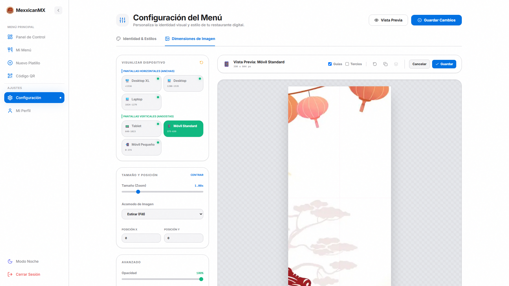

**Menú Público:**
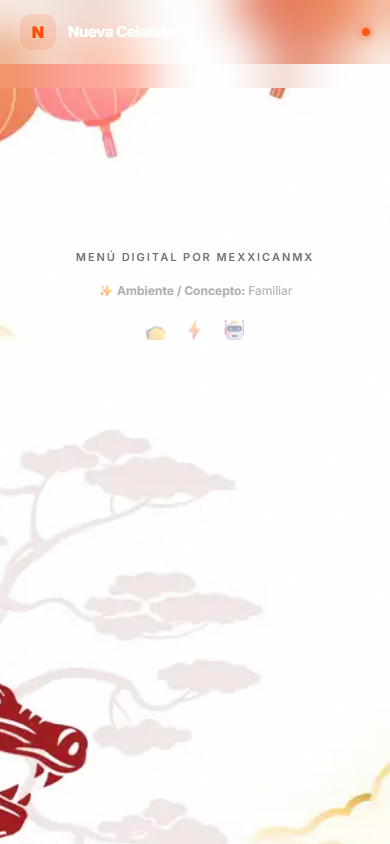

### Propiedades CSS

| Propiedad | Editor | Menú Público | Coinciden? |
|---|---|---|---|
| width | 768px | 768px | ✅ |
| height | 1024px | 1024px | ✅ |
| objectFit | fill | fill | ✅ |
| transform | none | none | ✅ |
| borderRadius | 0px | 0px | ✅ |
| opacity | 1 | 1 | ✅ |
| zIndex | auto | auto | ✅ |

### Persistencia

- **object_fit guardado como "fill":** ✅ Sí
- **UI refleja valor persistido:** ✅ Sí

**Respuesta del servidor al guardar:**
```json
{
  "mensaje": "Configuración de marca actualizada correctamente",
  "tema": {
    "id": "5222e341-1ac0-40f2-852f-d660892500ee",
    "restaurante_id": "51ad632a-403d-426e-bfb4-2d32a448bb7b",
    "logo_url": "",
    "banner_url": null,
    "color_primario": "#FF4A00",
    "color_fondo": "#0A0A0A",
    "fuente_familia": "Sans-Serif",
    "layout_type": "TARJETAS_DETALLADAS",
    "banner_promocional_activo": false,
    "banner_promocional_texto": "",
    "config_diseno": {
      "layout": {
        "categorias_sticky": true,
        "layout_type_vertical": "TARJETAS_DETALLADAS",
        "layout_type_horizontal": "TARJETAS_DETALLADAS"
      },
      "apariencia": {
        "fondo_blur": "0px",
        "fondo_tipo": "imagen",
        "color_fondo": "#0A0A0A",
        "fondo_valor": "#0A0A0A",
        "modo_oscuro": true,
        "color_normal": "#ffffff",
        "color_primario": "#FF4A00",
        "fondo_imagen_x": 0,
        "fondo_imagen_y": 0,
        "fuente_familia": "Sans-Serif",
        "fondo_imagen_url": "https://d13mim0hny1xpb.cloudfront.net/dishes/1785367031587-712226456.webp",
        "color_descripcion": "#8e8e93",
        "fondo_imagen_blur": 0,
        "fondo_imagen_zoom": 1,
        "responsive_imagen": {
          "laptop": {
            "scale": 1,
            "width": 300,
            "custom": true,
            "height": 300,
            "opacity": 100,
            "z_index": 0,
            "rotation": 0,
            "object_fit": "fill",
            "position_x": 50,
            "position_y": 50,
            "border_radius": 0
          },
          "mobile": {
            "scale": 1,
            "width": 768,
            "custom": true,
            "height": 1024,
            "opacity": 100,
            "z_index": 1,
            "rotation": 0,
            "object_fit": "fill",
            "position_x": 0,
            "position_y": 0,
            "border_radius": 0
          },
          "tablet": {
            "scale": 1,
            "width": 768,
            "custom": true,
            "height": 1024,
            "opacity": 100,
            "z_index": 1,
            "rotation": 0,
            "object_fit": "fill",
            "position_x": 0,
            "position_y": 0,
            "border_radius": 0
          },
          "desktop": {
            "scale": 1,
            "width": 300,
            "custom": true,
            "height": 300,
            "opacity": 100,
            "z_index": 0,
            "rotation": 0,
            "object_fit": "fill",
            "position_x": 50,
            "position_y": 50,
            "border_radius": 0
          },
          "mobile_small": {
            "scale": 1,
            "width": 768,
            "custom": true,
            "height": 1024,
            "opacity": 100,
            "z_index": 1,
            "rotation": 0,
            "object_fit": "fill",
            "position_x": 0,
            "position_y": 0,
            "border_radius": 0
          },
          "desktop_large": {
            "scale": 1,
            "width": 2560,
            "custom": true,
            "height": 1440,
            "opacity": 100,
            "z_index": 1,
            "rotation": 0,
            "object_fit": "fill",
            "position_x": 0,
            "position_y": 0,
            "border_radius": 0
          }
        },
        "fondo_imagen_rotate": 0,
        "fondo_imagen_opacity": 100,
        "border_radius_botones": "12px",
        "fondo_imagen_contrast": 100,
        "fondo_imagen_saturate": 100,
        "fondo_overlay_opacity": 0,
        "border_radius_tarjetas": "24px",
        "fondo_imagen_brightness": 100,
        "fondo_overlay_gradient_active": false
      },
      "informacion": {
        "ambiente": "Familiar",
        "direccion": ""
      },
      "elementos_visuales": {
        "glassmorphism": false,
        "sombras_habilitadas": true
      }
    },
    "updated_at": "2026-07-30T01:43:11.557Z"
  }
}
```

---

## Móvil Pequeño (mobile_small)

**Estado:** ✅ PASÓ
**Grupo:** vertical

### Capturas

**Editor:**
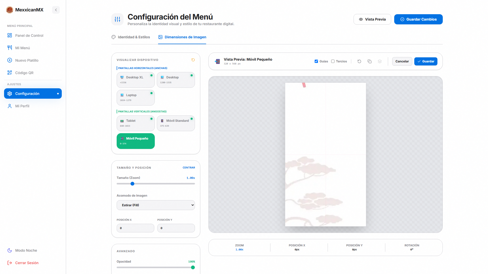

**Menú Público:**
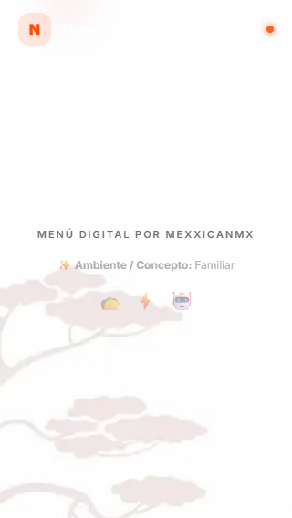

### Propiedades CSS

| Propiedad | Editor | Menú Público | Coinciden? |
|---|---|---|---|
| width | 768px | 768px | ✅ |
| height | 1024px | 1024px | ✅ |
| objectFit | fill | fill | ✅ |
| transform | none | none | ✅ |
| borderRadius | 0px | 0px | ✅ |
| opacity | 1 | 1 | ✅ |
| zIndex | auto | auto | ✅ |

### Persistencia

- **object_fit guardado como "fill":** ✅ Sí
- **UI refleja valor persistido:** ✅ Sí

**Respuesta del servidor al guardar:**
```json
{
  "mensaje": "Configuración de marca actualizada correctamente",
  "tema": {
    "id": "5222e341-1ac0-40f2-852f-d660892500ee",
    "restaurante_id": "51ad632a-403d-426e-bfb4-2d32a448bb7b",
    "logo_url": "",
    "banner_url": null,
    "color_primario": "#FF4A00",
    "color_fondo": "#0A0A0A",
    "fuente_familia": "Sans-Serif",
    "layout_type": "TARJETAS_DETALLADAS",
    "banner_promocional_activo": false,
    "banner_promocional_texto": "",
    "config_diseno": {
      "layout": {
        "categorias_sticky": true,
        "layout_type_vertical": "TARJETAS_DETALLADAS",
        "layout_type_horizontal": "TARJETAS_DETALLADAS"
      },
      "apariencia": {
        "fondo_blur": "0px",
        "fondo_tipo": "imagen",
        "color_fondo": "#0A0A0A",
        "fondo_valor": "#0A0A0A",
        "modo_oscuro": true,
        "color_normal": "#ffffff",
        "color_primario": "#FF4A00",
        "fondo_imagen_x": 0,
        "fondo_imagen_y": 0,
        "fuente_familia": "Sans-Serif",
        "fondo_imagen_url": "https://d13mim0hny1xpb.cloudfront.net/dishes/1785367031587-712226456.webp",
        "color_descripcion": "#8e8e93",
        "fondo_imagen_blur": 0,
        "fondo_imagen_zoom": 1,
        "responsive_imagen": {
          "laptop": {
            "scale": 1,
            "width": 300,
            "custom": true,
            "height": 300,
            "opacity": 100,
            "z_index": 0,
            "rotation": 0,
            "object_fit": "fill",
            "position_x": 50,
            "position_y": 50,
            "border_radius": 0
          },
          "mobile": {
            "scale": 1,
            "width": 768,
            "custom": true,
            "height": 1024,
            "opacity": 100,
            "z_index": 1,
            "rotation": 0,
            "object_fit": "fill",
            "position_x": 0,
            "position_y": 0,
            "border_radius": 0
          },
          "tablet": {
            "scale": 1,
            "width": 768,
            "custom": true,
            "height": 1024,
            "opacity": 100,
            "z_index": 1,
            "rotation": 0,
            "object_fit": "fill",
            "position_x": 0,
            "position_y": 0,
            "border_radius": 0
          },
          "desktop": {
            "scale": 1,
            "width": 300,
            "custom": true,
            "height": 300,
            "opacity": 100,
            "z_index": 0,
            "rotation": 0,
            "object_fit": "fill",
            "position_x": 50,
            "position_y": 50,
            "border_radius": 0
          },
          "mobile_small": {
            "scale": 1,
            "width": 768,
            "custom": true,
            "height": 1024,
            "opacity": 100,
            "z_index": 1,
            "rotation": 0,
            "object_fit": "fill",
            "position_x": 0,
            "position_y": 0,
            "border_radius": 0
          },
          "desktop_large": {
            "scale": 1,
            "width": 2560,
            "custom": true,
            "height": 1440,
            "opacity": 100,
            "z_index": 1,
            "rotation": 0,
            "object_fit": "fill",
            "position_x": 0,
            "position_y": 0,
            "border_radius": 0
          }
        },
        "fondo_imagen_rotate": 0,
        "fondo_imagen_opacity": 100,
        "border_radius_botones": "12px",
        "fondo_imagen_contrast": 100,
        "fondo_imagen_saturate": 100,
        "fondo_overlay_opacity": 0,
        "border_radius_tarjetas": "24px",
        "fondo_imagen_brightness": 100,
        "fondo_overlay_gradient_active": false
      },
      "informacion": {
        "ambiente": "Familiar",
        "direccion": ""
      },
      "elementos_visuales": {
        "glassmorphism": false,
        "sombras_habilitadas": true
      }
    },
    "updated_at": "2026-07-30T01:43:38.092Z"
  }
}
```

---

## Recomendaciones Generales

4. **Herencia entre breakpoints:** Verificar que la herencia separada por grupos (Horizontal → desktop_large > desktop > laptop, Vertical → tablet > mobile > mobile_small) funciona correctamente y que un breakpoint inferior hereda solo si el superior tiene `custom: true`.

